# ModuleModo: как это работает

Процедурные лоуполи-модули стен для дома. Blender 5.2+.

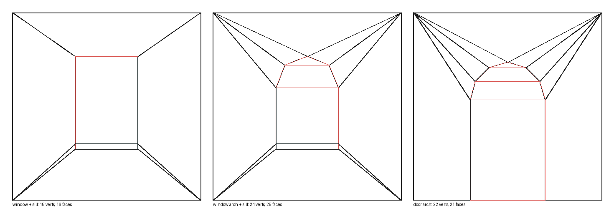

## Установка

1. Edit → Preferences → Get Extensions.
2. Стрелка в правом верхнем углу → **Install from Disk…**.
3. Выберите `dist/house_modules.zip`.
4. Включите **ModuleModo**, если он не включился сам.

Если Windows пишет «Access is denied»: закройте проводник в папке расширений и повторите.

## Где кнопки

Есть два места.

**1. Боковая панель (клавиша N) во вьюпорте, вкладка ModuleModo.** Заголовок панели показывает имя и версию («ModuleModo vX.X.X»). Сорок пять кнопок собраны в семь сворачиваемых групп. Связанные варианты стоят в одном ряду: слева подпись, справа кнопки.

| Группа | Ряд (подпись) | Кнопки | Что создаёт |
|---|---|---|---|
| **Windows** | Window | With Sill, No Sill | стена с окном, с подоконником и без |
| | 2 Windows | Horizontal, Vertical | два окна рядом или друг над другом |
| | Shutters | Straight, Round, Pointed | окно с отдельными ставнями; арочное; стрельчатое |
| | Trim | Lintel, Pediment, Arch Band | окно с трапецией над ним; окно с фронтоном; арочное окно с арочной полосой |
| | | Arch Band + Keystone | арочная полоса с замковым камнем |
| | Panel | Under, Above | окно с панелью под ним; окно с панелью над ним |
| | Wall | Belt Course, Pilasters | окно с поясом и гладкой стеной над ним; окно с пилястрами по краям |
| | Frame | Straight, Arched | окно с рамкой; арочное окно с рамкой |
| | | Pointed Window | высокое стрельчатое (готическое) окно |
| | | Window + Plinth + Cornice | окно с цоколем и карнизом |
| **Doors and Entrance** | | Door | стена с дверью на порожке |
| | Entrance | Porch, Canopy, 2 Doors | дверь и плита у входа; плита и козырёк; две двери рядом (подъезд и подвал) |
| | Entrance + Stairs | Stairs, Canopy, 2 Doors | приподнятый вход 4 м: площадка на 1 м и шесть ступеней от земли |
| **Corners** | Outer Corner | 2 Windows, 1 Window | внешний угол с окном на каждой стене или на одной, цоколь и карниз |
| | Inner Corner | 2 Windows, 1 Window | то же для внутреннего угла |
| **Bay Windows** | Bay | Splayed, Box | эркер с окнами: трапециевидный или прямоугольный |
| | Full Height | Plain, Plinth, Cornice | эркер на всю ширину и высоту модуля, без верха и низа, для этажей; нижний этаж с цоколем, верхний с карнизом |
| **Balcony and Loggia** | Balcony | With Slab, No Slab | балконная дверь слева, окно справа, с плитой-балконом или без неё |
| | Loggia | Door + Window, Door Only | ниша в фасаде с парапетом, внутри дверь и окно или только одна дверь по центру |
| **Underground and Attic** | | Underground (below Z=0) | подземный модуль 3 × 0.5 под нулём |
| | Attic | Plain, Window | технический этаж 3 × 1: глухой и с окошком 0.5 × 0.5 |
| | Attic + Cornice | Plain, Window | то же с карнизом |
| **Other** | | Solid Wall | просто плоскость без проёма |

Нажмите на заголовок группы, чтобы свернуть или развернуть её. Каждая группа помнит своё состояние отдельно.

В описаниях модулей ниже кнопки названы полными именами, например **Corner: 2 Windows**. На панели это ряд **Outer Corner** и кнопка **2 Windows**.

Каждая кнопка задаёт все размеры сама (размер окна, высоту от пола, количество и т. д.), поэтому не наследует значения предыдущей кнопки. Дальше всё можно поменять в F9.

Если вкладки не видно: нажмите N во вьюпорте и поищите вкладку **ModuleModo** в правой колонке вертикальных вкладок. Панель видна только в 3D-вьюпорте, не в UV-редакторе.

**2. Меню Add → Mesh → Wall Module.** Создаёт окно с подоконником.

## Правило края модуля

Модули потом сшиваются в один дом, поэтому на вертикальном краю модуля стоят только его угловые точки (внизу и вверху), без промежуточных. Для этого плиты, козырёк и эркер не доходят до края: отступ минимум 0.1 м, у эркера ещё и вынос подоконника, рамки и наличника. Полоса стены между краем и плитой строится так: одна длинная четырёхугольная грань и веер из коротких треугольников у ближнего угла, без длинных тонких треугольников.

Исключения: цоколь, карниз и пояс добавляют на краю свои точки (у соседа должны быть такие же), у пилястр край имеет свой профиль, а у пары окон друг над другом на краю есть одна лишняя пара точек на уровне стыка ячеек.

## Размеры по умолчанию

Кнопки используют типовые размеры (в метрах):

| Кнопка | Размер проёма | От пола | Зазор |
|---|---|---|---|
| Window Wall, No Sill | 1.2 × 1.4 | 0.9 | |
| 2 Windows (Horizontal) | 0.8 × 1.4 каждое | 0.9 | 0.6 |
| 2 Windows (Vertical) | 1.2 × 0.7 каждое | 0.7 (нижнее) | 0.4 |
| Door Wall | 0.9 × 2.1 | порожек 0.1 | |
| Entrance | дверь 1.0 × 2.1 (две по 0.9) | порожек 0.1 над плитой 0.2 | 0.3 |
| Balcony: Door + Window | дверь 0.9 × 2.1, окно 1.2 × 1.2 | дверь на порожке 0.1 над плитой, верх окна вровень с дверью | 0.4 |
| Pointed Window | 0.8 × 2.0, высота острия 0.9 | 0.7 | |
| Window + Pediment, Arched Window + Keystone, Window + Panel, Window Wall + Belt Course, Window Wall + Pilasters | как у окна; арочное 1.2 × 1.6; фронтон 0.35, камень +0.04, панель 0.5 × 0.03, пояс 0.12 × 0.06 с гладкой стеной 0.3, пилястры 0.25 × 0.1 | 0.9 | |
| Window + Frame, Arched Window + Frame | как у окна; арочное 1.2 × 1.6; рамка 0.12 шириной, вынос 0.04 (с подоконником до 0.12) | 0.9 | |
| Window + Lintel, Arched Window + Archivolt | как у окна; арочное 1.2 × 1.6; трапеция высотой 0.35, шире на 0.15, арочная полоса 0.2, вынос 0.06 | 0.9 | |
| Loggia | дверь 0.9 × 2.1, окно 1.2 × 1.2; ниша 2.6 м шириной, 1.2 м над парапетом, глубина 1.2 | пол лоджии 0.3, парапет 1.1 | 0.4 |
| Loggia (Door Only) | дверь 0.9 × 2.1 по центру; ниша 2.0 м шириной, остальное как у Loggia | пол лоджии 0.3, парапет 1.1 | |
| Corner, Inner Corner | окно 1.2 × 1.4 на каждой стене (стены по 3 м) | 0.9 | |
| Bay Window | эркер 2.6 м шириной, вынос 0.8, скос 0.5, высота 2.0; окно 1.0 × 1.2 | низ эркера 0.6, окно 0.4 от низа эркера | |
| Bay Window (Full Height) | эркер на весь модуль, вынос 0.8, скос 0.5; окно 1.2 × 1.4 | 0.9 | |

Стена по умолчанию 3 × 3 м, глубина ниши 0.2 м, подоконник 0.08 м толщиной и 0.12 м вылетом. Цоколь 0.3 м высотой и 0.15 м выносом, карниз 0.3 м высотой и 0.25 м выносом. Всё это меняется в F9.

## Настройки модуля

После создания откройте панель **Adjust Last Operation** в левом нижнем углу вьюпорта (или нажмите F9). Параметры можно менять сразу, пока вы не сделали следующую операцию.

Почти все числовые поля с ограниченным диапазоном сделаны **слайдерами** (поле с цветной заливкой): размеры окна и двери, глубина ниши, смещение, высота от пола, число окон, подоконник, рамка, наличник, панель, пояс, пилястры, цоколь, карниз, эркер, лоджия, балкон, вход, число сегментов арки, угол сглаживания. Слайдер можно тянуть мышью, а точное число вводится двойным щелчком по полю (или Ctrl+клик). Обычными числовыми полями остались Width и Height самой стены, там проще набрать точное значение. Если значение у минимума (например, Count = 1), заливки не видно, но это тоже слайдер.

**Модуль**
- **Width, Height:** размер стены, по умолчанию 3 × 3 м.
- **Pivot:** Bottom Center (центр снизу, по умолчанию) или Corner (левый нижний угол, удобно для сетки).

**Проём**
- **Opening:** Window, Door или None.
- **Width, Height:** размер проёма.
- **Depth:** на сколько проём вдавлен в стену.
- **Offset X:** сдвиг проёма от центра стены.
- **Height from Floor:** высота окна от пола (только для окна; у двери низ всегда на полу). Для вертикальной группы это высота нижнего окна.
- **Count:** сколько проёмов в стене, от 1 до 3.
- **Layout:** Horizontal (рядом) или Vertical (друг над другом). Vertical работает только для окон, у дверей всегда горизонтально.
- **Gap:** расстояние между соседними проёмами (появляется при Count больше 1).

**Арка сверху**
- **Arched Top:** включает арку.
- **Arch:** тип арки. **Round** это дуга окружности, не выше полукруга. **Pointed** это стрельчатая (готическая) арка из двух дуг, сходящихся в острие.
- **Arch Rise:** высота арки. Для Round половина ширины проёма даёт полукруг. Для Pointed значение больше половины ширины: чем выше, тем острее окно (для окна 0.8 м хорошо 0.9 м). Меньше полукруга для Pointed не бывает, значение подтянется.
- **Segments:** количество сегментов арки (2–32), по умолчанию 8. Для Pointed число считается на обе стороны вместе и округляется до чётного, острие всегда одна вершина. Для лоуполи хватает 4–6.

**Подоконник** (только для окна)
- **Window Sill:** включить или выключить подоконник.
- **Thickness:** толщина подоконника по высоте.
- **Depth:** на сколько он выступает из стены.

**Прочее**
- **Smooth by Angle:** сглаживание по углу, то же, что Shade Smooth by Angle в Blender, без модификатора. Рёбра положе порога получают гладкое затенение, острее остаются жёсткими. Прямые углы 90° всегда жёсткие, а ступеньки арки смягчаются.
- **Angle:** порог сглаживания, по умолчанию 30°. Шаг дуги у арки зависит от числа сегментов: при 8 сегментах у полукруга шаг 22.5°, и арка сглаживается; при 4 сегментах шаг 45°, и она остаётся гранёной. Хотите гладкую арку на малом числе сегментов, поднимите угол (например, до 50°), но не выше 90°, иначе сгладятся и прямые углы.
- **Auto UV:** сразу после построения модуля сама делает развёртку, тем же способом, что Auto UV в TechArt Tools: Cube Projection по всему мешу, затем Pack Islands без поворота и с масштабированием. Лицевая сторона стены, нижние грани ниш и подоконников, плита получаются отдельными островками, внутри 0–1.
- **UV Margin:** отступ между островками при упаковке, по умолчанию 0.01.

Плотность текселей после Auto UV у разных модулей будет разной, потому что Pack Islands масштабирует развёртку под весь тайл. Выровнять её можно инструментами Texel в TechArt Tools.

Значения, которые не помещаются в стену (например, три окна шире стены), автоматически уменьшаются, так что модуль всегда строится. Размер, высота от пола, арка и подоконник у всех проёмов одинаковые; **Offset X** сдвигает всю группу целиком.

## Как строится меш

Так же, как вы сделали бы это руками: **Plane → Inset → Extrude**.

1. **Плоскость.** Одна плоскость в Y=0. Нормаль смотрит в **+Y**. Толщины и задней стороны нет.
2. **Inset проёма.** Вокруг проёма четыре грани, а диагонали идут от углов стены к углам проёма (на картинке сверху).
3. **Extrude проёма.** Внутренняя грань проёма вдавливается на `Depth` в сторону **−Y**. Вокруг неё появляются стенки.
4. **Заливка.** Внутри ниши только четырёхугольники и, при чётном числе сегментов арки, один треугольник. Для арки это прямоугольник и горизонтальные полосы по дуге.
5. **Арка сверху.** Стена над аркой это веер треугольников из двух верхних углов стены.
6. **Подоконник.** Прямоугольник на плоскости под окном, выдавленный в **+Y**. К его краям идут диагонали из нижних углов стены.
7. **Дверь.** Низ ниши открыт, нижней стенки и нижней трапеции нет.

### Стрельчатые окна

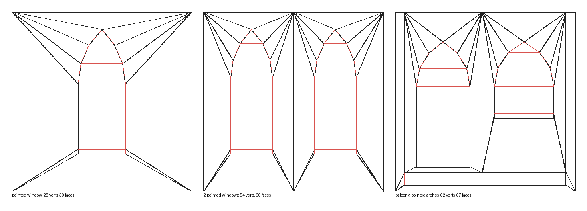

Тип арки Pointed работает везде: у одного окна, у групп из нескольких окон, у двери и окна на балконе. Кнопка **Pointed Window** создаёт высокое стрельчатое окно 0.8 × 2.0 м. Топология та же, что у круглой арки: заливка горизонтальными полосами с одним треугольником у острия и веер из верхних углов стены.

Если проём слишком низкий для заданной высоты острия, арка автоматически становится обычной круглой.

### Угловой модуль

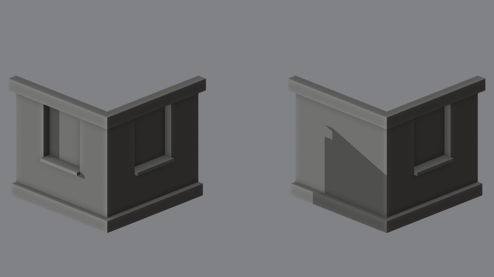

Тип проёма **Corner** это внешний угол дома: две стены, которые сходятся в вертикальном ребре. Одна стена (A) смотрит в +Y и идёт по -X, вторая (B) смотрит в +X и идёт по -Y. Начало координат стоит внизу в самом углу (pivot здесь не нужен).

- **Windows:** либо **Both Walls** (группа окон на каждой стене), либо **One Wall** (окна только на стене A, вторая стена глухая).
- Всё остальное как у оконного модуля: размер и высота окна, высота от пола, количество (Count) и расстояние (Gap), арки (круглые и стрельчатые), подоконник, глубина ниши. **Offset X** сдвигает окна от угла (положительное значение) или к углу.
- **Width** это длина каждой из двух стен, по умолчанию 3 м, значит модуль занимает 3 × 3 м в плане.
- **Plinth и Cornice** огибают угол: на каждой стене пояс свой, а в углу они сходятся косым стыком (митра): передний край каждого пояса доходит до внешнего угла, и две стороны встречаются по одной диагонали, без лишних вершин на фронтальных гранях. Нижняя грань цоколя есть, как у обычного.
- Угловое ребро общее для обеих стен: меш замкнут без швов и Т-стыков.

Кнопки:

| Кнопка | Что создаёт |
|---|---|
| Corner: 2 Windows | угол с окном на каждой стене, цоколь и карниз |
| Corner: 1 Window | угол с окном на одной стене, цоколь и карниз |

### Внутренний угол

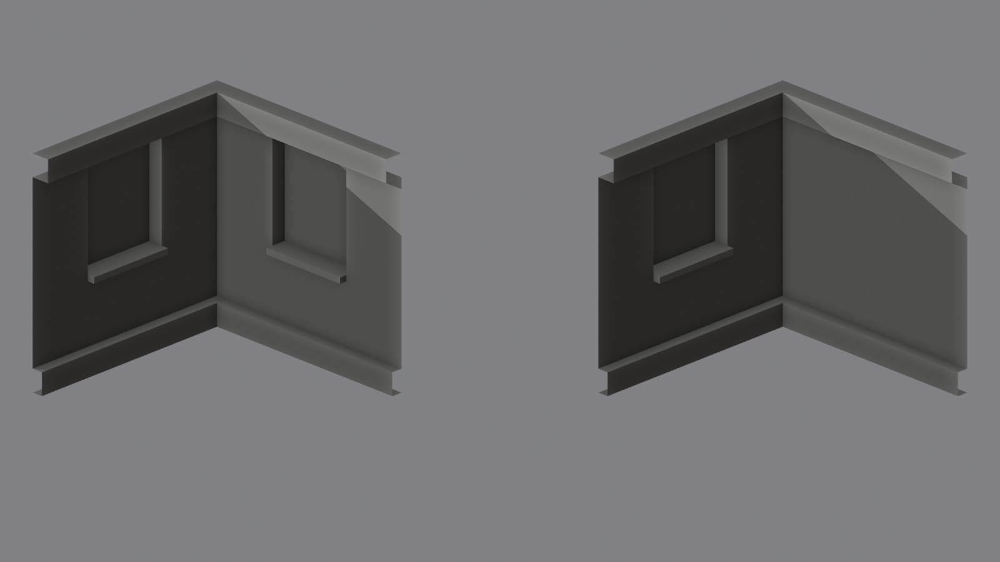

Тип проёма **Inner Corner** это внутренний угол дома (ниша между двумя крыльями Г-образного здания). Обе стены смотрят в четверть между ними. Стена A идёт по +X и смотрит в +Y, стена B идёт по +Y и смотрит в +X. Начало координат внизу в самом углу, как у внешнего.

- Параметры те же, что у **Corner**: **Windows** (**Both Walls** или **One Wall**), размеры и число окон, арки, подоконники, **Plinth** и **Cornice**. **Offset X** сдвигает окна от угла.
- Пояса сходятся косым стыком, как у внешнего угла, но здесь передний край пояса каждой стены **укорачивается** до внутренней вершины, а не вытягивается наружу. Лишних вершин нет.
- Внешний и внутренний угол по размерам одинаковы (по 52 вершины и 44 грани с обоими поясами и окнами на обеих стенах).

Кнопки:

| Кнопка | Что создаёт |
|---|---|
| Inner Corner: 2 Windows | внутренний угол с окном на каждой стене, цоколь и карниз |
| Inner Corner: 1 Window | внутренний угол с окном на одной стене, цоколь и карниз |

### Эркер

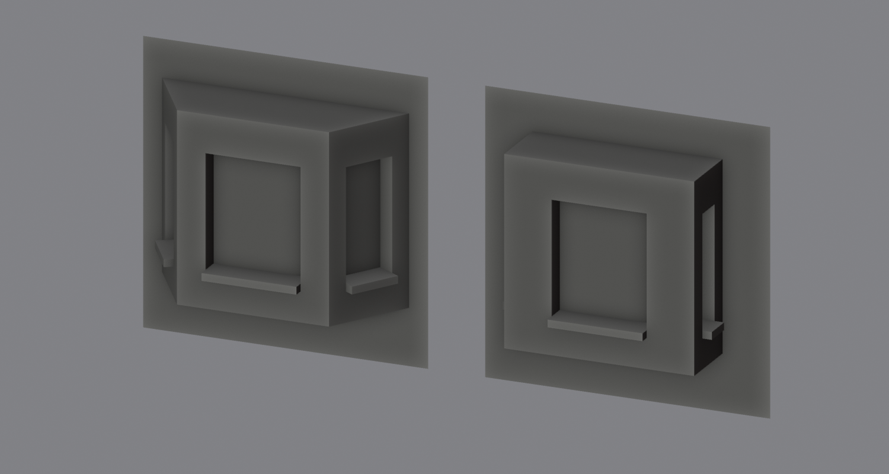

Тип проёма **Bay Window** это эркер: объём, выступающий из стены, только с окнами. Фасад получает прямоугольный проём, а эркер собирается из трёх готовых оконных стенок (фронт и две боковые), потолка и пола. Все части делят вершины друг с другом, поэтому меш замкнут без Т-стыков и дубликатов.

- **Bay Width** ширина эркера у стены (2.6 м), **Bay Depth** вынос (0.8 м).
- **Splay** на сколько фронт уже с каждой стороны (0.5 м). Боковые грани идут под углом, получается трапециевидный эркер. При **Splay = 0** эркер прямоугольный.
- **Bay Floor Height** и **Bay Height** где стоит низ эркера над низом модуля (0.6 м) и его высота (2.0 м).
- **Windows on the Sides** окна и на боковых гранях, а не только на фронте.
- Окно настраивается как у оконного модуля: **Width**, **Height**, **Height from Floor** (от низа эркера), арки (круглые и стрельчатые), подоконник, глубина ниши. Окно одно на грань, **Offset X** двигает весь эркер по стене.
- Цоколь и карниз работают только у эркера **Full Height** (у обычного эркера их нет). Цоколь делают для нижнего этажа, карниз для верхнего, средние этажи без поясов. Пояса идут вдоль всех трёх граней и на концах модуля имеют тот же профиль, что у прямых модулей, так что продолжаются в соседний модуль.
- Пояс на боковых гранях получается тоньше, чем на фронте: он сдвигается на глубину пояса вдоль +Y, чтобы на краю модуля совпасть с поясом соседней стены. Чем больше **Splay**, тем толще пояс на боках.
- В режиме Full Height скос боков (**Splay**) не меньше 0.25 м, с поясами и без них, чтобы этажи с поясами и без них стыковались. Совсем прямоугольного полноразмерного эркера нет.
- **Full Height:** эркер на всю ширину и высоту модуля, без верха и низа и без стены вокруг. Остаются только три грани с окнами: фронт и два боковых крыла. Такие модули ставятся друг на друга и склеиваются в сплошной эркер на несколько этажей, а боковыми рёбрами стыкуются с соседними стенами. Подоконники у окон остаются. В этом режиме **Bay Width**, **Bay Floor Height**, **Bay Height** и **Offset X** не нужны.

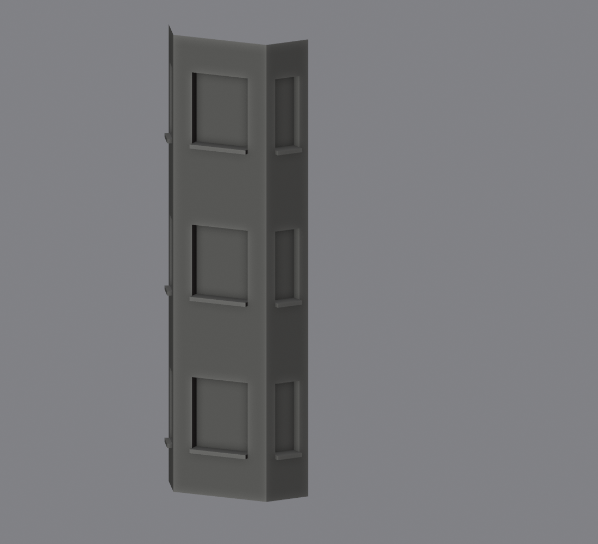

Кнопки:

| Кнопка | Что создаёт |
|---|---|
| Bay Window | трапециевидный эркер с окнами на фронте и на боках |
| Bay Window (Box) | прямоугольный эркер |

### Наличники: трапеция над окном и арочная полоса

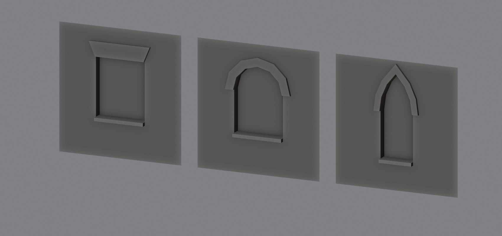

Архитектурные украшения над проёмом. Это куски плоскости над окном, выдавленные наружу, как подоконник, поэтому меш остаётся замкнутым, без Т-стыков и дубликатов вершин. Включаются галочкой **Window Trim** (для окон, дверей, углов и эркеров) и подходят как к прямым, так и к круглым и стрельчатым окнам.

- **Над прямым верхом: трапеция (сандрик).** Прямоугольник над проёмом, расширяющийся кверху. Параметры **Lintel Height** (высота, 0.35 м) и **Lintel Flare** (на сколько шире окна с каждой стороны вверху, 0.15 м). Расширение само ограничивается, чтобы верхние углы трапеции не заходили за диагонали соседних граней.
- **Над аркой: арочная полоса.** Полоса вдоль арки, у которой горизонтальные пятки на уровне пят арки, как на вашем эскизе. Работает и с круглой, и со стрельчатой аркой. Параметр **Arch Band Width** (ширина полосы, 0.2 м).
- **Trim Depth:** на сколько украшение выступает из стены, 0.06 м.
- Если над окном не хватает места (до верха ячейки меньше 5 см), украшение для этого окна пропускается.

Кнопки: ряд **Trim** в группе Windows: **Lintel** (окно с трапецией) и **Arch Band** (арочное окно с полосой).

### Рамка окна

Рамка вокруг окна: две стойки и верхняя перекладина, выдавленные наружу. Включается галочкой **Window Frame** (для окон, дверей, углов и эркеров). Меш остаётся замкнутым, без Т-стыков и дубликатов вершин.

- **Прямое окно:** стойки по бокам и плоская перекладина сверху. Внизу рамку замыкает подоконник, а без него нижняя перекладина.
- **Арочное окно (круглое и стрельчатое):** стойки до уровня пят арки и арочная полоса над ними, как у арочного наличника.
- **Frame Width:** ширина стоек и перекладины, 0.12 м. **Frame Depth:** вынос из стены, 0.04 м.
- **Без подоконника** рамка у окна замкнутая: две стойки, верхняя перекладина и нижняя перекладина под окном. У двери и проёмов у самого пола нижней перекладины нет, рамка там имеет вид П.
- **С подоконником** рамка стоит на нём, это два отдельных объёма: подоконник становится шириной в рамку и выступает на свою глубину, а рамка тоньше и выступает на свою (вид сбоку: тонкий прямоугольник рамки на толстом прямоугольнике подоконника). Нижних граней у стоек нет, они стоят вплотную к плоскому верху подоконника. Если глубина рамки не меньше глубины подоконника, они сливаются в один объём с общей лицевой плоскостью.
- Рамка заменяет наличник (трапецию и арочную полосу): если включены оба, действует рамка.
- Если вокруг окна не хватает места, рамка для этого окна пропускается.

Кнопки: ряд **Frame** в группе Windows: **Straight** (прямое окно с рамкой) и **Arched** (арочное окно с рамкой).

### Ставни

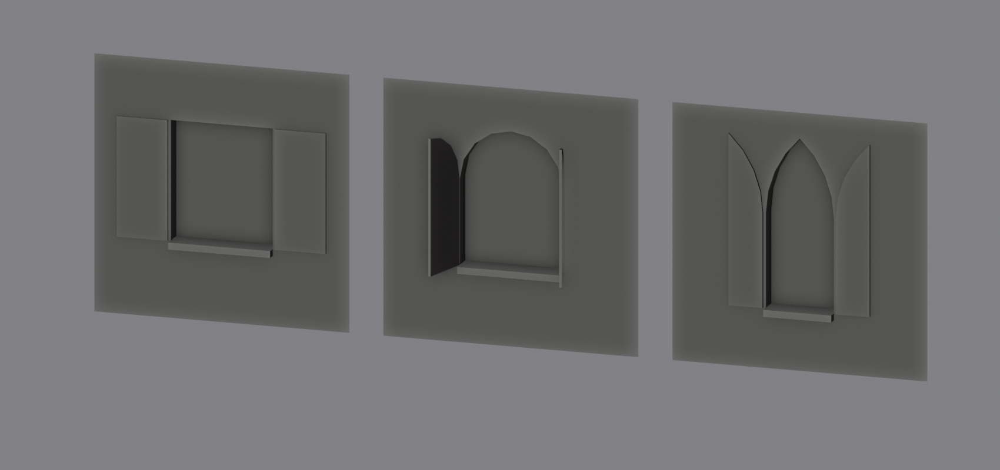

Ставни это **отдельные объекты**, не вшитые в стену, чтобы их можно было поворачивать, открывать и закрывать. Включаются галочкой **Shutters** (только для прямого оконного модуля: на углах, эркере и двери их нет).

- **Две ставни на окно**, слева и справа, каждая ложится на стену задней гранью (на плоскость стены) и выступает на **Shutter Depth** (0.03 м). Ставня замкнутый объём, с задней гранью, поэтому её можно повернуть на любой угол или закрыть на окно. Ширина каждой равна половине окна, если рядом хватает места (до соседнего окна или края ячейки). Если места меньше 10 см, ставен у этого окна нет, например у крайних окон при трёх окнах в ряд.
- **Начало координат на оси петли.** У каждой ставни точка отсчёта стоит на вертикальной оси у откоса окна, на высоте низа окна. Поэтому ставню достаточно повернуть вокруг оси Z: **+90°** для правой и **-90°** для левой открывают её наружу, к зрителю.
- **Родитель.** Ставни дочерние объекты модуля: двигаете модуль, ставни едут вместе с ним. Имена `Shutter_L1`, `Shutter_R1` (для второго окна `L2`, `R2`).
- **Форма.** У прямого окна это прямоугольник. У круглого и стрельчатого окна верх ставни повторяет половину арки, развёрнутую от петли: у откоса ставня ниже, а у свободного края выше. Так выглядит раскрытая ставня арочного окна.
- Если у окна есть рамка или арочный наличник, ставни стоят снаружи от них.
- Меш каждой ставни чистый и замкнутый: четырёхугольники и треугольники, без Т-стыков. Для каждой ставни тоже делается Smooth by Angle и Auto UV.
- **Закрыть ставни.** Поверните каждую на 180°: ось петли стоит на плоскости стены, поэтому закрытая ставня ляжет в нишу окна. Если ниша мелкая (Depth меньше глубины ставни), ставня уйдёт в стену.

Кнопки: ряд **Shutters** в группе Windows: **Straight**, **Round**, **Pointed**.

### Подземный модуль и технический этаж

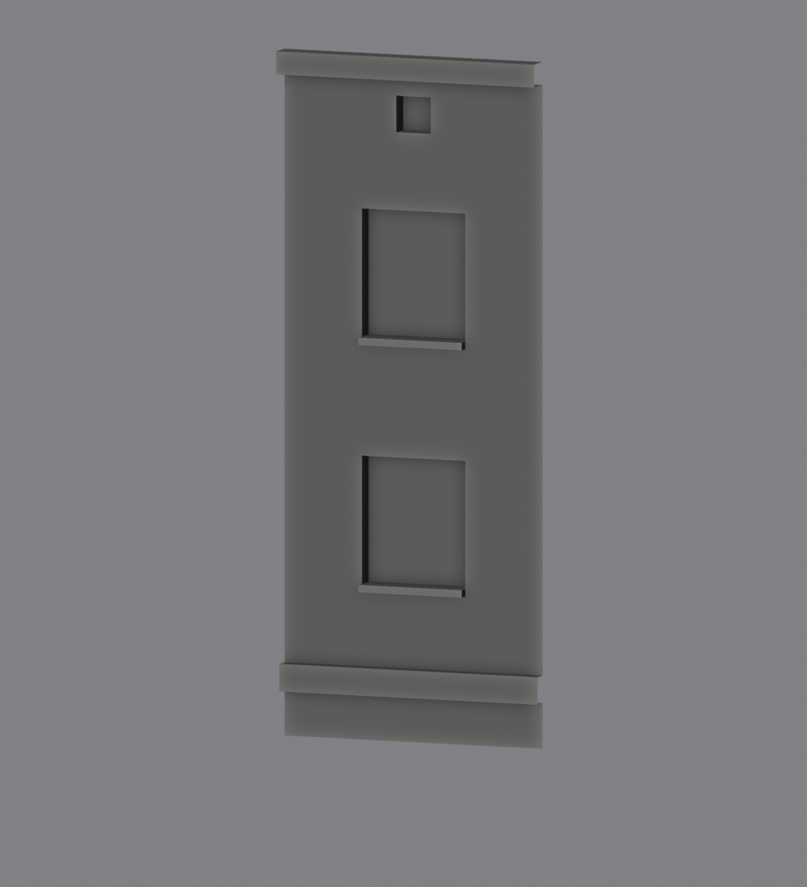

Два низких модуля для сборки здания: подземный ряд под нулевым уровнем и технический этаж над последним этажом. Группа кнопок **Underground and Attic**.

- **Подземный модуль (Underground).** Глухая стена шириной 3 м и высотой **0.5 м**, которая строится **вниз** от нулевого уровня: верхняя кромка на Z=0, нижняя на Z=-0.5. Пивот остаётся на уровне 0 (по центру, как у обычных модулей). Включается галочкой **Below Ground** в F9: она работает с любым модулем (кроме угловых) и сдвигает его вниз на его высоту. Глубина задаётся полем **Height** (0.5 м по умолчанию). На краях только угловые точки, так что он сшивается с соседями как обычная стена.
- **Технический этаж (Attic).** Низкий модуль над последним этажом, по умолчанию 3 × **1 м** (поле **Height**, можно 2 м). Кнопки: **Plain** (глухая стена) и **Window** (с квадратным окошком-продухом 0.5 × 0.5 м, без подоконника; его можно включить галочкой **Window Sill** в F9), а также те же два варианта с карнизом (**Attic + Cornice**, карниз 0.25 м, окошко 0.4 × 0.4 м). Это обычный модуль малой высоты, поэтому всё остальное доступно в F9: рамка, наличник, пояс, цоколь, пилястры, несколько окошек (**Count**) и так далее.
- **Размер сбрасывается кнопкой.** Все кнопки теперь задают ширину и высоту сами (3 × 3 м, а у этих двух 3 × 0.5 и 3 × 1), поэтому подземный модуль или технический этаж не оставляют свою высоту следующей кнопке. Нестандартный размер меняйте в F9 после создания.

**Для сборщика ProcBuilder:** подземный модуль подходит для роли `underground`, а технический этаж для верхней полосы. Прямые модули ModuleModo уже соответствуют его соглашению: лицевая сторона по +Y, пивот внизу по центру на плоскости стены, 3 × 3 м. Угловой модуль ProcBuilder ждёт для северо-западного угла: чтобы получить такой из внешнего угла ModuleModo (он северо-восточный), поверните его на **+90° вокруг Z** и примените поворот (Ctrl+A).

### Фронтон, замковый камень, панель под окном, пояс и пилястры

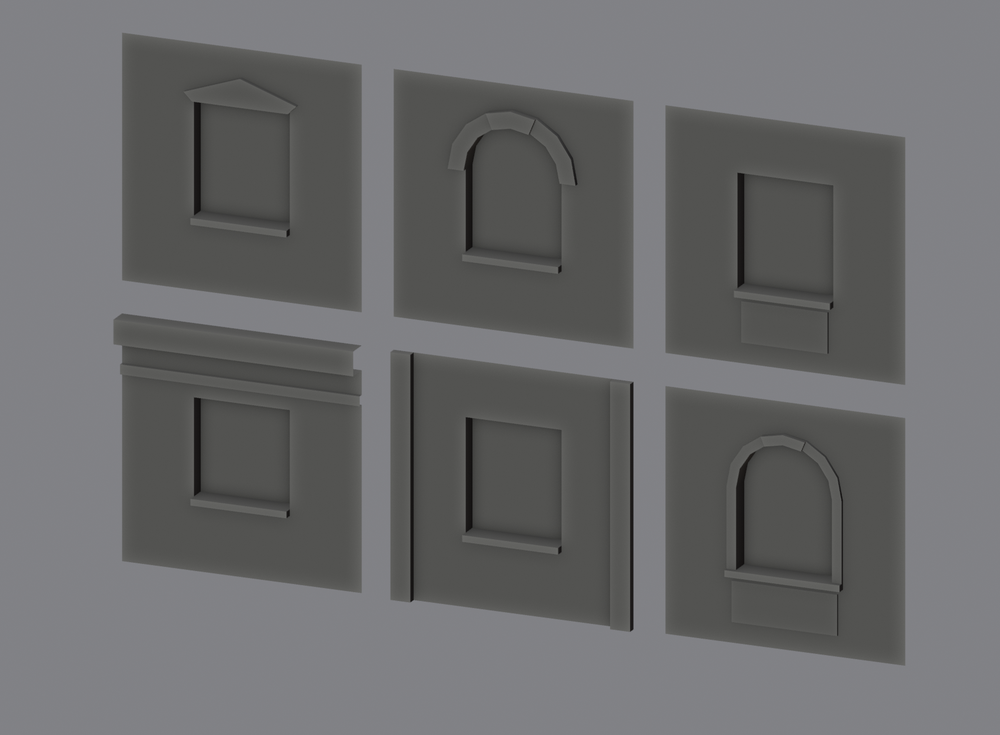

Все эти украшения тоже куски плоскости, выдавленные наружу, поэтому меш остаётся замкнутым, без Т-стыков и дубликатов вершин.

- **Фронтон (Pediment).** Над прямым окном вместо трапеции стоит «домик»: короткие боковые стенки и треугольный фронтон. Включается галочкой **Pediment** при включённом **Window Trim**, размеры те же: **Lintel Height** (полная высота до вершины) и **Lintel Flare** (на сколько шире окна). Над аркой галочка не действует: там остаётся арочная полоса.
- **Замковый камень (Keystone).** Клин на вершине арки, шире кверху, как в классической арке: низ вровень с внутренним краем арки, верх выше внешнего края полосы, и камень выступает ещё на **Keystone Depth** (0.04 м) дальше полосы. Это отдельный блок, он не сшит с полосой и стеной и лежит на стене с открытым задником (заднюю грань на плоскости стены не видно, её нет). Боковые грани наклонены к центру арки. **Keystone Width** (0.2 м) ширина низа, **Keystone Height** (0.12 м) на сколько камень поднимается над полосой. Кнопка **Arch Band + Keystone** ставит 9 сегментов арки: при нечётном числе на вершине стоит грань, а не вершина, и камень ложится на неё симметрично. Блок работает при любом числе сегментов. Работает над арочным наличником и над арочной рамкой, для круглой и стрельчатой арки; если над аркой не хватает места, камень ниже или его нет.
- **Панель над окном (Panel above Window).** 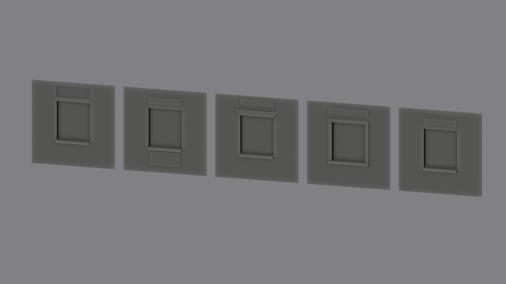 Такой же выступающий прямоугольник, только над окном: в кольце из четырёх граней, как панель под окном. Он встаёт над тем, что есть над окном (рамка, прямой сандрик или просто проём), с зазором **Gap above Window** (0.15 м). **Top Panel Height** 0.25 м, **Top Panel Depth** 0.03 м (отрицательное значение вдавливает панель в стену). По ширине она ровно как окно (с рамкой: как внешняя кромка рамки); **Side Inset** (0 по умолчанию) сужает её с каждой стороны. Общих вершин с окном у неё нет: она стоит выше на зазор. Над арками и фронтоном панели нет: там стена над проёмом режется веером треугольников. Если до верха ячейки мало места, панель не строится. Работает на окне, двери, глухом окне углов и эркера. Для сочетания с цоколем и карнизом окно должно быть ниже: чем больше места над ним, тем выше можно сделать панель.
- **Панель под окном (Panel under Window).** Прямоугольник стены под подоконником (или под нижней перекладиной рамки), вытянутый наружу на **Panel Depth** (0.03 м). Отрицательное значение вдавливает панель в стену. **Panel Height** по умолчанию 0.5 м. Панель отступает от края подоконника на 6 см, так что с подоконником и рамкой общих вершин у неё нет. Если под окном мало места, панель не строится.
- **Межэтажный пояс (Belt Course).** Тонкая полоса поперёк стены над проёмами и полоса гладкой стены над ней: **Belt Height** 0.12 м, **Belt Depth** 0.06 м, **Wall above Belt** 0.3 м. Окна при этом ниже, потому что пояс и полоса над ним забирают часть высоты модуля. Если включён карниз, между ним и поясом остаётся не меньше 5 см. Пояс не поддерживается для эркера.
- **Пилястры (Pilasters).** Вертикальные выступы на концах модуля на всю высоту: **Both**, **Left**, **Right**. **Pilaster Width** 0.25 м, **Pilaster Depth** 0.1 м. Окно сдвигается в оставшуюся ширину. Пилястры работают на окне, двери, глухой стене и на углах (на углу они стоят на дальних концах двух стен, сам угол остаётся гладким). С цоколем, карнизом и поясом они не сочетаются: при их включении пилястры не строятся, в F9 появляется подсказка. Для лоджии, балкона, входа и эркера пилястр нет.

Кнопки: в группе Windows ряд **Trim** получил третью кнопку **Pediment**, ниже идут **Arch Band + Keystone**, ряд **Panel** (**Under** и **Above**) и ряд **Wall** с кнопками **Belt Course** и **Pilasters**.

### Цоколь и карниз (парапет)

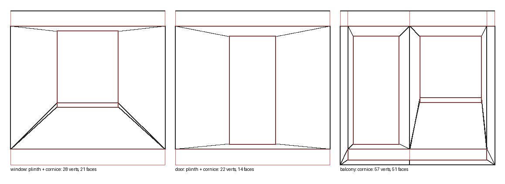

К любому модулю (окно, дверь, балкон, лоджия, вход, глухая стена) можно добавить выступающий пояс внизу и вверху. Это прямоугольник плоскости на всю ширину модуля, выдавленный наружу в +Y, как на вашем виде сбоку.

- **Plinth:** пояс внизу (цоколь). У него есть нижняя грань: на втором этаже он не стыкуется с модулем снизу, а на первом эту грань можно удалить руками. Параметры **Plinth Height** (0.3 м) и **Plinth Depth** (0.15 м).
- **Cornice:** пояс вверху (карниз, парапет). Верхняя и нижняя грани есть. Параметры **Cornice Height** (0.3 м) и **Cornice Depth** (0.25 м).
- Торцы поясов открыты, как и сказано в эскизе: соседние модули продолжают пояс без шва, цоколь и карниз получаются сплошными.
- Сам модуль строится в оставшейся высоте и сдвигается на высоту цоколя, поэтому общая высота модуля остаётся прежней (3 м).
- Вершины пояса общие с краем модуля, Т-стыков нет. Ширина пояса делится ровно по тем вершинам, которые уже есть на краю модуля (например, по линии между двумя окнами).
- У входа с плитой цоколь игнорируется: плита и так стоит на земле и работает как цоколь.
- У двери без порожка (Door Step = 0) ниша остаётся открытой до пола, то есть до верха цоколя. Для двери с цоколем оставляйте порожек.

Включаются галочками в F9 (Adjust Last Operation). Кнопка **Window Wall + Plinth + Cornice** делает окно сразу с обоими поясами.

### Дверь с порожком

Кнопка **Door Wall** теперь делает дверь с порожком (**Door Step**, по умолчанию 0.1 м): дверь стоит чуть выше низа модуля, под ней есть полоска стены и пол ниши. Раньше ниша была открыта до пола, как буква «П». Если поставить Door Step в 0, получится старый вариант без порожка. Две двери рядом это та же кнопка с **Count = 2**.

### Вход: порог, плита и козырёк

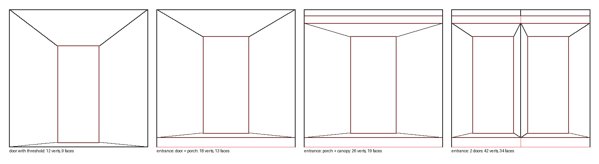

Тип проёма **Entrance** это входная группа из одной, двух или трёх дверей. Плита у входа и козырёк делаются так же, как плита балкона и подоконник: прямоугольник на плоскости, выдавленный наружу в +Y.

- **Porch Slab:** плита перед дверями. Она стоит на земле, поэтому её нижней грани нет (под ней будет земля), а двери стоят на порожке над плитой. Плита шире и длиннее балконной: по умолчанию на всю ширину модуля и 1.5 м вперёд.
- **Canopy:** козырёк над дверями. Это такая же плита сверху, но у неё есть и нижняя, и верхняя грань. Над козырьком стена продолжается.
- **Count:** 1–3 двери. Для варианта «подъезд и подвал» ставьте 2.

Кнопки:

| Кнопка | Что создаёт |
|---|---|
| Entrance: Door + Porch | дверь на порожке и плита у входа |
| Entrance: Porch + Canopy | то же и козырёк над дверью |
| Entrance: 2 Doors | две двери рядом (подъезд и подвал), плита и козырёк |

Параметры:
- **Door Width, Door Height, Door Step, Count, Gap:** размеры дверей, порожек, количество и расстояние между ними.
- **Porch Thickness, Porch Depth:** толщина плиты (0.2 м) и вынос (1.5 м).
- **Canopy Thickness, Canopy Depth, Gap above Door:** толщина козырька (0.15 м), вынос (1.0 м) и расстояние от верха двери до козырька (0.3 м).
- **Side Margin:** сколько обычной стены остаётся слева и справа от плиты и козырька, по умолчанию и минимум 0.1 м. Меньше нельзя: на краю модуля должны остаться только его угловые точки, иначе он не сошьётся с соседним.
- Арки (круглые и стрельчатые) работают у дверей так же, как у окон.

### Лестница у входа

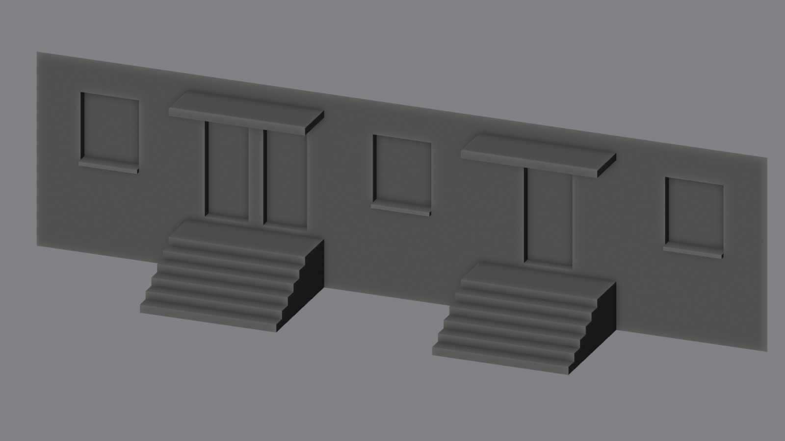

Для приподнятого входа (первый этаж выше земли) у входной группы есть лестница. Она заменяет плиту крыльца: площадка с дверями лежит на высоте **Rise** (1 м по умолчанию) над землёй, а ступени идут от неё вниз до земли (Z=0). Пивот остаётся внизу по центру, на земле.

**Высота модуля 4 м.** Кнопки с лестницей создают модуль высотой 4 м: 1 м основания и 3 м этажа. Стена идёт от земли до верха, поэтому боковые кромки (только две угловые вершины, Z от 0 до 4) совпадают с соседними модулями с окнами высотой 4 м, и всё сшивается в одну стену. Если ваши соседи выше или ниже, меняйте **Height** в F9, а у соседей ставьте ту же высоту.

- **Stairs:** включает лестницу вместо плиты. Поля плиты (Porch Thickness, Porch Depth) при этом скрыты.
- **Rise:** высота площадки над землёй, по умолчанию 1 м (от 0.3 до 3 м). Дверь стоит на площадке (с порожком Door Step), поэтому для двери 2.1 м и козырька нужен модуль высотой от 4 м.
- **Steps:** число подъёмов, по умолчанию 6 (высота одного около 0.17 м), от 2 до 20.
- **Tread Depth:** глубина одной ступени, по умолчанию 0.3 м.
- **Landing Depth:** глубина площадки перед дверями, по умолчанию 1 м.
- **Side Margin** действует как у плиты: слева и справа от лестницы остаётся не меньше 0.1 м стены.

Лестница это сплошное тело без нижней грани и без задней (она стоит на земле у стены). На земле у каждой боковой стенки только две вершины: задний угол и носок нижней ступени. Боковая стенка состоит из четырёхугольника у площадки, веера треугольников из заднего нижнего угла и маленького прямоугольного треугольника в каждой ступени. Веер даёт длинные узкие треугольники, но они лежат в плоскости боковой стенки, её почти не видно, зато вершин на 12 меньше. Козырёк работает как обычно. Цоколь у входа с лестницей игнорируется.

| Кнопка | Что создаёт |
|---|---|
| Entrance: Stairs | модуль 4 м: дверь на площадке и шесть ступеней от земли |
| Entrance: Stairs + Canopy | то же и козырёк |
| Entrance: Stairs, 2 Doors | две двери рядом, лестница и козырёк |

### Лоджия

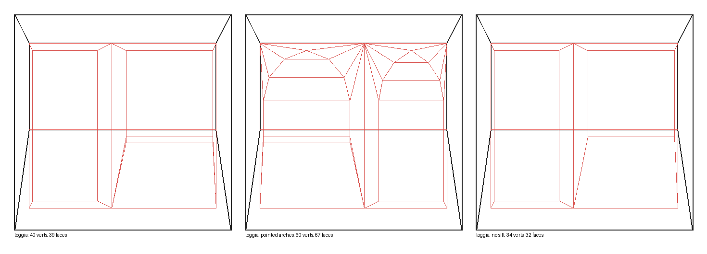

Тип проёма **Loggia** это балкон, утопленный внутрь стены на глубину балкона. Строится как три экструда:

1. Прямоугольник проёма в фасаде вдавливается на толщину парапета: получается верхняя грань парапета.
2. Он же вдавливается дальше, до задней стены лоджии.
3. Нижняя грань этой ниши вдавливается вниз до пола лоджии: получаются внутренняя стенка парапета, пол и нижние части боковых стен.

Снаружи видно только проём над парапетом, а низ двери и окна закрыт парапетом. Задняя стена лоджии обычная: дверь и окно построены так же, как у балкона, дверь стоит на полу лоджии с порожком (не меньше 3 см). Арки, подоконник окна и «Door on Right» работают так же. В варианте **Door Only** вместо двери с окном на задней стене одна дверь по центру: меш получается легче (24 вершины и 21 грань против 40 и 39).

Параметры лоджии:
- **Back Wall:** что на задней стене лоджии: **Door + Window** (дверь и окно) или **Door Only** (одна дверь по центру, без окна). В режиме Door Only параметры окна, **Gap** и **Door on Right** не нужны.
- **Loggia Width:** ширина ниши, по умолчанию 2.6 м. Положение сдвигает **Offset X**.
- **Opening Height:** высота проёма над парапетом, по умолчанию 1.2 м.
- **Loggia Depth:** глубина ниши, по умолчанию 1.2 м, как у плиты балкона.
- **Floor Height:** высота пола лоджии над низом модуля, по умолчанию 0.3 м.
- **Parapet Height:** высота парапета над полом лоджии, по умолчанию 1.1 м. Проём начинается над ним.
- **Parapet Thickness:** толщина парапета, по умолчанию 0.15 м.
- **Door Width, Door Height, Door Step, Window Width, Window Height, Gap, Depth:** размеры двери и окна на задней стене, как у балкона.

Вершины на фасаде, потолке, парапете, полу и задней стене общие, поэтому Т-стыков и дубликатов нет. Единственные «лишние» вершины по центру лоджии лежат на самой задней стене, где сходятся ячейки двери и окна. Потолок и пол стыкуются с ними четырёхугольником и треугольником, поэтому на фасаде, парапете и передних краях пола и потолка по центру вершин нет. Боковые Г-образные стенки разбиты диагональю на два четырёхугольника.

### Балкон: дверь, окно и плита

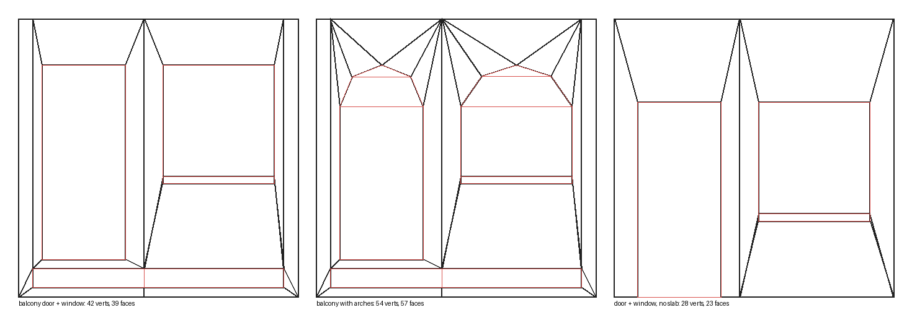

Новый тип проёма **Door + Window**. Дверь и окно стоят рядом, их верх на одной высоте. Дверь по умолчанию слева, если смотреть на лицевую сторону (с +Y); галочка **Door on Right** меняет их местами.

Плита балкона делается так же, как подоконник: прямоугольник на плоскости, выдавленный наружу в +Y, только шире и толще. Между дверью и плитой есть порожек (**Door Step**, по умолчанию 0.1 м): дверь стоит чуть выше плиты, как в обычном доме. Под плитой тоже остаётся полоска стены. Если поставить Door Step в 0, дверь встанет прямо на плиту, и пол её ниши продолжит плиту.

Параметры плиты (появляются при включённом **Balcony Slab**):
- **Door Step:** порожек, на сколько дверь выше плиты, по умолчанию 0.1 м.
- **Slab Thickness:** толщина плиты, по умолчанию 0.2 м.
- **Slab Depth:** на сколько плита выступает из стены, по умолчанию 1.2 м.
- **Side Margin:** сколько обычной стены остаётся слева и справа от плиты, по умолчанию 0.15 м, минимум 0.1 м (причина та же: на краю модуля только угловые точки).
- **Bottom Offset:** высота полоски стены под плитой, по умолчанию 0.1 м.

Параметры двери: **Door Width**, **Door Height**. Окно использует **Window Width**, **Window Height** (верх окна всегда вровень с дверью) и обычный подоконник. Арка, если включена, делается на обоих проёмах. Если выключить **Balcony Slab**, получается модуль «дверь и окно» без плиты, дверь стоит на полу.

Боковые полоски стены рядом с плитой сделаны веером из нижнего угла стены к двум вершинам на торце плиты, без лишних вершин на внешнем крае. Вершины на плите, под ней и вокруг двери общие, так что Т-стыков и дубликатов нет.

### Несколько окон

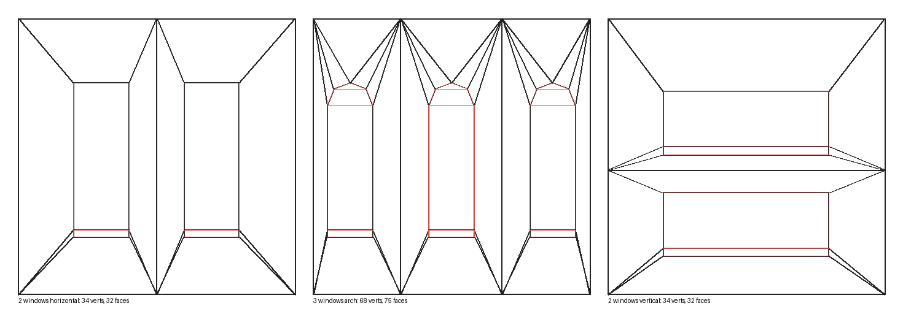

Стена режется на ячейки, по одной на каждое окно. Границы ячеек проходят ровно посередине между соседними окнами. Внутри каждой ячейки делается свой inset с диагоналями из углов ячейки и свой extrude, а вершины на общих границах склеены, так что дубликатов нет. У каждого окна свой подоконник.

Итог для одного окна: окно без подоконника 12 вершин и 9 граней, окно с подоконником 18 вершин и 16 граней, окно с аркой на 4 сегмента и подоконником 24 вершины и 25 граней. Два окна рядом с подоконниками: 34 вершины и 32 грани.

## Направления и размеры

- Лицевая сторона стены смотрит в **+Y**, ниша уходит в **−Y**, подоконник выступает в **+Y**.
- Чтобы увидеть лицевую сторону, смотрите с **Ctrl + Numpad 1**. Обычный Numpad 1 покажет заднюю.
- Плоскость лежит в нуле по Y, то есть pivot стоит прямо на ней.

## Советы

- Стыковка модулей: берите **Pivot = Corner** и ставьте стены с шагом 3 м по сетке.
- Если нужна другая толщина стены, сделайте Solidify или Extrude по Y уже на готовом модуле.
- Подоконник можно выключить в любой момент через F9, галочка **Window Sill**.
- Сборка архива из исходников: `build.ps1` в папке аддона.

## Файлы аддона

| Файл | Назначение |
|---|---|
| `generator.py` | построение меша (чистый bmesh, без привязки к интерфейсу) |
| `operators.py` | оператор Wall Module и его параметры |
| `ui.py` | боковая панель с кнопками |
| `blender_manifest.toml` | имя, версия, требования |
| `build.ps1` | сборка установочного архива |

## Лицензия

Аддон бесплатный и с открытым кодом, лицензия GNU GPL v3 или новее (файл `LICENSE`), та же семья лицензий, что и у самого Blender. Модули, которые вы сгенерировали, можно использовать в любых проектах, в том числе коммерческих.
