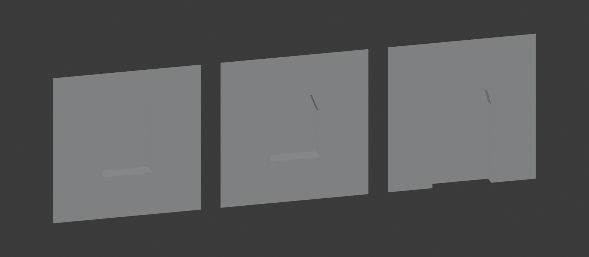

# ModuleModo

Procedural low-poly wall modules for Blender 5.2+.

**Add > Mesh > Wall Module**, or the **ModuleModo** tab in the 3D viewport sidebar. All parameters live in the redo panel, so they can be tweaked right after creation.

The module is built the way you would model it by hand: **plane, inset, extrude**.

- One plane at Y=0 facing +Y (default 3 x 3 m), no thickness and no back side
- The opening is inset into four faces with diagonals from the wall corners to the opening corners, then its inner fill (quads and one triangle) is pushed back by `Depth` towards -Y
- Opening: window, door (open at the floor) or solid plane; size, offset, height from floor
- Corner module: two window walls meeting at an outer corner, with the plinth and cornice wrapping around it (windows on both walls or on one)
- Inner corner module: the matching inner corner, bands mitred along one diagonal
- Plinth (bottom band) and cornice (top band) for any module: full-width rectangles extruded out of the wall (the plinth keeps its bottom face), open at the sides so neighbouring modules continue them
- Door with a threshold; entrance module: 1-3 doors on a threshold with a porch slab (no bottom face, it stands on the ground) and an optional canopy slab
- Loggia module: a recess in the facade (three extrudes) with a parapet in front, door and window on its back wall
- Balcony module: door and window side by side with tops aligned, optional balcony slab under them (a thick, long sill)
- 1 to 3 openings, side by side or stacked (windows); the wall is cut into one cell per opening, each cell gets its own inset and extrude
- Arched top: round or pointed (gothic) arch, arch rise and segment count; the wall above the arch is a fan from the two top corners
- Window sill (optional, or use the "Window Wall (No Sill)" button): the plane rectangle under the window extruded out towards +Y (thickness, depth)
- Pivot at the bottom center or the bottom-left corner
- Smooth by Angle (default 30 degrees): flat faces stay flat, steps along an arch get smooth shading, 90 degree corners stay hard; no modifier
- Auto UV right after modeling: cube projection and Pack Islands without rotation, margin 0.01 (the same recipe as Auto UV in TechArt Tools)

Build the installable zip with `build.ps1`.
